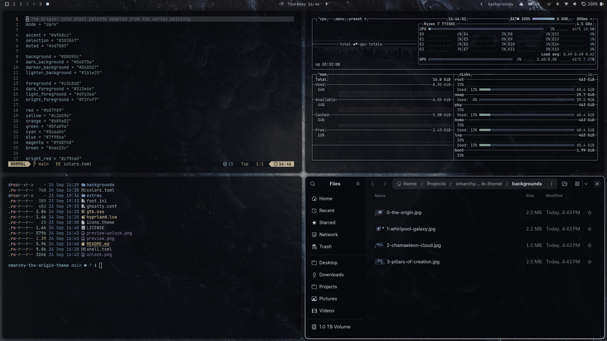

# The Origin

A cold, near-black [Omarchy](https://omarchy.org) theme named for and built around "The Origin", an oil painting of a luminous vortex by Luke Wilimitis. Steel-blue shadows, a silver-white glow, and softly translucent windows that let the painting breathe through.



## Install

Requires Omarchy 4 (the theme uses `hyprland.lua` and `shell.toml`).

```bash
git clone https://github.com/redeye1011/omarchy-the-origin-theme ~/.local/share/omarchy-the-origin-theme
ln -s ~/.local/share/omarchy-the-origin-theme ~/.config/omarchy/themes/the-origin
omarchy theme set the-origin
```

Optional, for GTK apps such as Files (Nautilus):

```bash
omarchy hook install theme-set ~/.local/share/omarchy-the-origin-theme/extras/50-gtk-css
omarchy theme set the-origin
```

Update with:

```bash
git -C ~/.local/share/omarchy-the-origin-theme pull && omarchy theme set the-origin
```

### Why not `omarchy theme install`?

`omarchy theme install <url>` works, but Omarchy treats a cloned theme as untrusted and drops its `*.lua` files and terminal configs, regenerating them from `colors.toml`. You would keep the palette, borders, and translucent shell, but lose the window rules and translucent terminals. A symlink to your own clone is trusted, so every file is kept.

If you only want the palette, wallpaper, and shell:

```bash
omarchy theme install https://github.com/redeye1011/omarchy-the-origin-theme
```

## What's included

| File | What it does |
|---|---|
| `colors.toml` | Steel palette sampled from the painting, with a steel-to-silver 45° border gradient |
| `hyprland.lua` | Border gradient, rounding 10, soft shadow, gaps 4/6, and window opacity rules |
| `shell.toml` | Bar, launcher, menus, notifications, OSD, and tooltips at 0.93 opacity |
| `ghostty.conf`, `foot.ini` | Palette with 0.93 background opacity |
| `gtk.css` | GTK / libadwaita colors at 0.93 opacity (needs `extras/50-gtk-css`) |
| `icons.theme` | `Yaru-blue-dark` |
| `backgrounds/` | "The Origin" by Luke Wilimitis, plus three Hubble and Webb images toned to match (see [Backgrounds](#backgrounds)) |
| `unlock.png`, `preview-unlock.png` | Logo cut from the painting's glowing core for the boot unlock and login screens. Apply it with *Style > Unlock > The Origin* (asks for your password and rebuilds the boot image) |
| `extras/50-gtk-css` | Theme-set hook that links the current theme's `gtk.css` into `~/.config/gtk-3.0/` and `~/.config/gtk-4.0/`, and removes the link for themes without one |

Btop, Neovim, Helix, Chromium, VS Code, Obsidian, and the rest are generated by Omarchy from `colors.toml`.

### Translucency

Everything skinned sits at the same 0.93 opacity, with no blur:

- Terminals, GTK apps, and shell surfaces are translucent through their own background alpha, so text stays fully solid.
- Other apps get the same 0.93 through a Hyprland window rule.
- Browsers, video apps, and games keep Omarchy's near-opaque default, because transparency breaks video and WebGL.

## Backgrounds

Four, picked from the background switcher (`Super + Ctrl + Space`). The painting sorts first and is the default.

| File | Image |
|---|---|
| `0-the-origin.jpg` | "The Origin", oil on canvas, by Luke Wilimitis |
| `1-whirlpool-galaxy.jpg` | The Whirlpool Galaxy (M51) and its companion, from Hubble |
| `2-chamaeleon-cloud.jpg` | The Chamaeleon I molecular cloud, from Webb |
| `3-pillars-of-creation.jpg` | The Pillars of Creation, from Hubble |

The three space images were cropped to 3840×2160, converted to grayscale, and mapped onto the theme's steel palette so they sit next to the painting. Add your own in `~/.config/omarchy/backgrounds/the-origin/` and they appear alongside these.

## Palette

| Role | Color | Role | Color |
|---|---|---|---|
| background | `#08090c` | foreground | `#c3c8d0` |
| lighter background | `#1b1e25` | bright foreground | `#f2f4f7` |
| selection | `#303847` | accent | `#a9b8cc` |
| muted | `#6d7885` | dark foreground | `#515e6e` |
| red | `#b07f89` | green | `#8fa89a` |
| yellow | `#c2b594` | orange | `#b89a82` |
| blue | `#7f98ba` | magenta | `#9d8fb8` |
| cyan | `#86aabb` | brown | `#6a625c` |

## Credits

### The Origin

The theme is named for **"The Origin"**, an oil painting by **Luke Wilimitis**.

- The painting: ["The Origin" on lukewilimitis.com](https://www.lukewilimitis.com/product/the-origin-original)
- Prints and originals: [lukewilimitis.com](https://www.lukewilimitis.com)
- More of his work: [instagram.com/luke_wilimitis](https://www.instagram.com/luke_wilimitis)

The painting (`backgrounds/0-the-origin.jpg`) and the unlock logo cut from it (`unlock.png`, `preview-unlock.png`) are included, and the theme carries the painting's name, with the artist's permission. All rights to the painting belong to the artist. If you like the theme, go follow and support him.

### Space images

Licensed under [CC BY 4.0](https://creativecommons.org/licenses/by/4.0/). Each was cropped to 3840×2160, converted to grayscale, and recolored to the theme's palette.

- `1-whirlpool-galaxy.jpg`: [Out of this whirl: The Whirlpool Galaxy (M51) and companion galaxy](https://esahubble.org/images/heic0506a/). Credit: NASA, ESA, S. Beckwith (STScI), and The Hubble Heritage Team (STScI/AURA).
- `2-chamaeleon-cloud.jpg`: [Webb's View of the Molecular Cloud Chameleon I](https://esawebb.org/images/weic2303a/). Credit: NASA, ESA, CSA, and M. Zamani (ESA/Webb); Science: F. Sun (Steward Observatory), Z. Smith (Open University), and the Ice Age ERS Team.
- `3-pillars-of-creation.jpg`: [New view of the Pillars of Creation — visible](https://esahubble.org/images/heic1501a/). Credit: NASA, ESA/Hubble and the Hubble Heritage Team.

Their use here does not imply endorsement by NASA, ESA, CSA, or STScI.

## License

The theme's configuration files are [MIT](LICENSE). The images in `backgrounds/`, `unlock.png`, and `preview-unlock.png` are not covered by that license; see [Credits](#credits).
